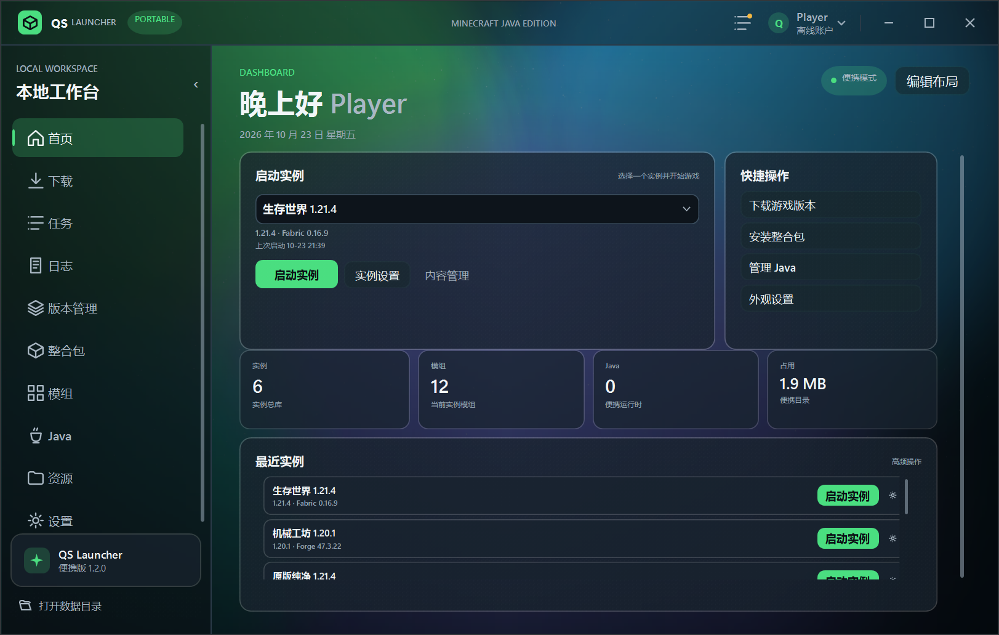
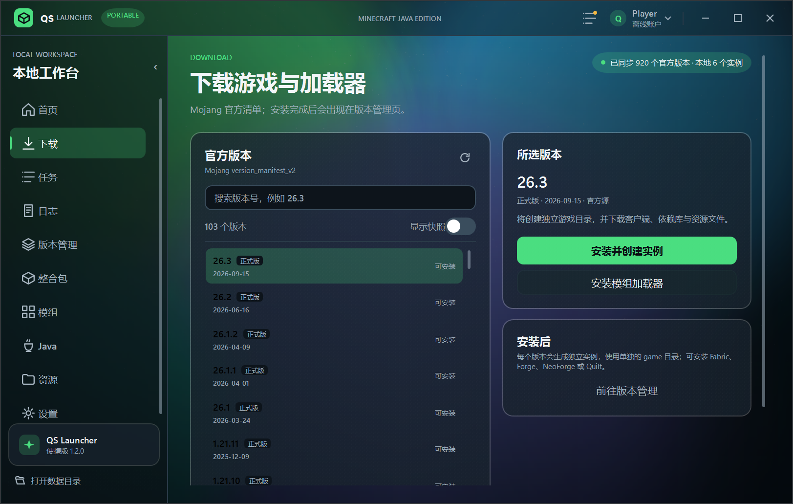
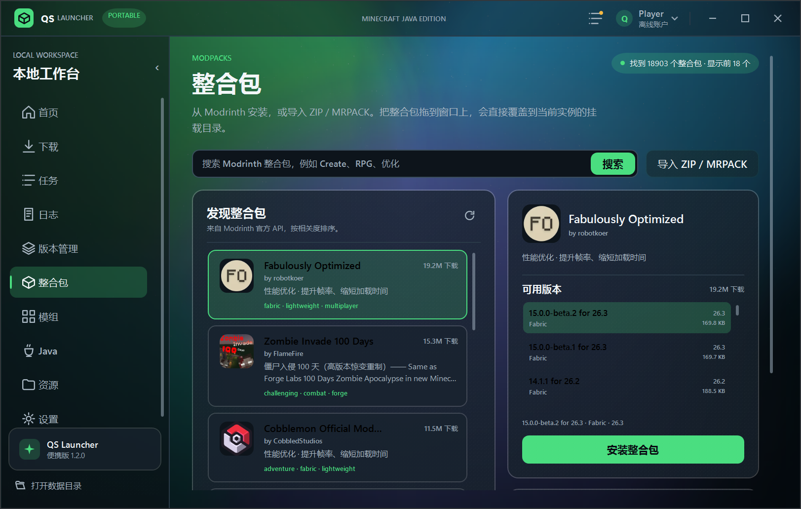
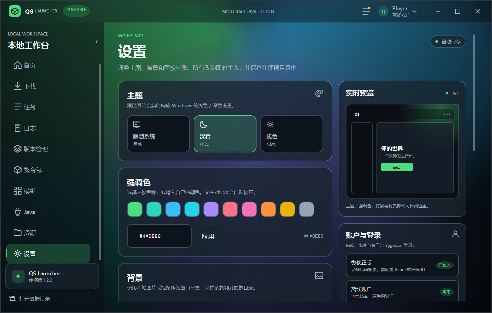

<div align="center">


# QS Launcher

**原生 · 便携 · 去中心化的 Minecraft Java 启动器**  
**A native, portable, decentralized launcher for Minecraft: Java Edition**

[简体中文](#简体中文) · [English](#english) · [最新发布](https://github.com/QiuSui1145/QSLauncher/releases) · [GPL-3.0](LICENSE)


</div>



---

## 简体中文

QS Launcher 是一个完全原生的 Windows Minecraft Java 版启动器，使用 **C# 14 + WPF + .NET 10** 编写。启动器本身不依赖 JavaScript、Python、Node.js、Electron、Tauri 或 WebView2。

它只有一个可执行文件。第一次运行时，程序会在 exe 旁边创建 `data/`；配置、账号令牌、实例、游戏资源、Java 运行时和日志都在这个目录里。整个文件夹可以复制到 U 盘或另一台电脑，不需要安装程序、注册表或管理员权限。

### 设计原则

- **去中心化**：没有启动器账号，没有中转下载，没有遥测，没有“登录启动器才能玩游戏”。
- **官方源**：所有下载相关功能都直接请求官方端点，不使用第三方镜像，也不经过启动器自己的服务器。
  - Mojang `version_manifest_v2`、版本 JSON、客户端、依赖库、资源对象与官方 CDN；
  - Modrinth 官方 API；
  - Fabric / Quilt 官方 meta 与 profile；
  - Forge / NeoForge 官方 Maven 与官方安装器；
  - Mojang 官方 Java 运行时索引；
  - authlib-injector 官方 GitHub Release（SHA-256 校验）。
- **完全便携**：`data/` 与 exe 同级；不写 `AppData`，不写注册表，不装服务。
- **原生界面**：自绘标题栏、导航、卡片、菜单、弹窗、进度与过渡动画；不使用系统默认控件外观，也不弹 Windows 原生文件选择框。

### 功能

#### 下载、版本与实例

- 独立“下载”页集中管理官方版本、加载器与安装入口；“版本管理”页只管理本地实例。
- Mojang 官方版本清单，支持正式版 / 快照 / 旧版筛选、搜索与安装。
- 原版客户端、依赖库、资源索引、资源对象和日志配置逐文件 SHA-1 校验。
- 每个实例拥有独立的 `game/`；模组、资源包、光影、存档、配置互不污染。
- 可注册多个 `.minecraft` 根目录，支持单目录挂载与多目录同时挂载；版本名带目录标签，例如 `26.2(主世界)`。
- 挂载目录中的版本、模组、配置和存档原地读取，不复制游戏文件。
- 实例设置包含内存、Java、JVM 参数、游戏参数；复制/删除实例带明确确认。
- 智能内存：先按模组、资源包、光影数量估算下限，再读取本机当前可用物理内存决定上限；内存充足时不会再固定卡在 4 GB。

#### 加载器与整合包

- Fabric / Quilt：官方 meta 与 profile 安装，可选择加载器版本。
- Forge / NeoForge：官方 Maven 元数据与官方安装器；自动准备 Java 8 与 `launcher_profiles.json`。
- Modrinth `.mrpack` 在线安装：解析 `modrinth.index.json`、依赖、哈希、`overrides/` 和客户端环境。
- 本地导入支持 **Modrinth `.mrpack`、CurseForge `manifest.json`、Prism/MultiMC `mmc-pack.json` 和普通 ZIP**。
- 普通 ZIP 自动识别 `version.json`、`.minecraft/version.json`、`minecraftinstance.json`、`PCL/Setup.ini` 或 `versions/<id>/<id>.json`。
- 把 `.zip` / `.mrpack` 拖到窗口，确认后会覆盖到**当前实例的挂载目录**；同名文件替换，本地已有文件保留。
- 安装失败会进入 `data/quarantine`，不留下半成品实例。

#### 模组

- 按当前实例的 Minecraft 版本与加载器搜索 Modrinth。
- 中文查询拆成关联词并行检索并合并去重，覆盖“优化”“小地图”“匠魂”“虚无世界”“应用能源”等常见说法。
- 优先展示中文简介，同时保留英文原文；支持 Modrinth 图标（含 WebP），失败回退首字母。
- 安装、启用/禁用、删除、本地 JAR 导入、拖拽 JAR 导入。
- 自动安装 Modrinth 必需前置依赖，带循环依赖保护。
- 检查更新与一键更新；用 `.qs-mods.json` 记录项目、版本和文件名。

#### Java 与账户

- 扫描系统 Java 8 / 21 / 25 等，显示版本、架构与路径。
- 从 Mojang 官方运行时索引安装 Java，按游戏版本自动匹配。
- 离线账号：本地生成确定性 UUID，不联网验证。
- Microsoft 正版：系统浏览器 OAuth，登录后本地回调自动收尾；令牌用 Windows DPAPI 加密保存。
- LittleSkin / Yggdrasil：支持自定义 API 根地址与多角色选择；启动前刷新令牌并注入 authlib-injector。
- 启动器不内置 Azure 客户端 ID 或密钥，需要用户填写自己的公共客户端 ID。

#### 界面、资源与日志

- 深色 / 浅色 / 跟随系统三态主题，强调色可自定义。
- 图片或视频背景，支持填充/适应、暗化、模糊、静音、循环和失焦暂停。
- 半透明磨砂面板：面板、菜单、按钮三层玻璃材质；菜单颗粒比面板低 10%，保证文字对比。
- 首页工作台控件可拖动、缩放、隐藏，布局保存到便携配置。
- 资源统计、缓存/日志/下载安全清理、资源包/光影/存档导入与隔离删除。
- 启动进度窗、实时日志、常见错误中文诊断、完整日志 ZIP 导出。

### 实机截图

所有截图来自 `artifacts/demo/` 独立演示目录，由脚本生成占位实例、占位模组与壁纸，**不含真实账号、日志或 `.minecraft` 挂载**。

| 下载与官方版本 | 整合包 |
| --- | --- |
|  |  |

| 外观与磨砂 | 首页工作台 |
| --- | --- |
|  |  |

### 快速开始

1. 下载发布包，解压到任意可写目录（不建议 `Program Files`）。
2. 双击 `QSLauncher.exe`，首次启动会创建 `data/`。
3. 打开“Java”页扫描或安装 Java。
4. 在“下载”页选择官方版本和加载器，或到“整合包”页安装 Modrinth 整合包 / 导入本地 ZIP。
5. 在“版本管理”查看实例，或把现有 `.minecraft` 添加为游戏加载目录。
6. 在“设置”调整主题、背景、磨砂和 Logo；右上角账户卡片添加离线 / 微软 / 第三方账号。
7. 回到首页点击“启动实例”。

### 构建

要求：Windows 10 22H2 / Windows 11 x64，.NET SDK 10。

```powershell
dotnet build QSLauncher.slnx -v:minimal
dotnet test QSLauncher.slnx -v:minimal
```

发布单文件自包含版：

```powershell
dotnet publish src/QSLauncher.App/QSLauncher.App.csproj `
  -c Release -r win-x64 --self-contained true `
  -p:PublishSingleFile=true `
  -p:IncludeNativeLibrariesForSelfExtract=true `
  -p:EnableCompressionInSingleFile=true `
  -p:PublishReadyToRun=false -p:DebugType=None `
  -o artifacts/publish/single
```

发布框架依赖轻量版（目标电脑需要 .NET 10 Desktop Runtime）：

```powershell
dotnet publish src/QSLauncher.App/QSLauncher.App.csproj `
  -c Release -p:RuntimeIdentifier=win-x64 -p:SelfContained=false `
  -p:PublishSingleFile=true `
  -p:PublishReadyToRun=false -p:DebugType=None `
  -o artifacts/publish/lite
```

使用发布脚本（自动递增补丁号、测试、构建完整版与轻量版）：

```powershell
powershell -ExecutionPolicy Bypass -File tools\publish-release.ps1
```

部署到指定目录时显式传入 `-DeployDir`：

```powershell
powershell -ExecutionPolicy Bypass -File tools\publish-release.ps1 -Version 1.2.0 -DeployDir D:\apps\QSLauncher
```

### 目录结构

```text
QSLauncher.exe
data/
  config.json              # 主题、背景、玻璃、下载、窗口设置
  accounts.json            # DPAPI 加密的账号令牌
  instances/<id>/          # 实例
    instance.json
    game/                  # mods, resourcepacks, shaderpacks, saves, options.txt
  meta/
    versions/              # 版本 JSON 与客户端 JAR
    libraries/             # 依赖库
    assets/                # 资源索引与 objects
  java/                    # Mojang 官方运行时
  cache/                   # 加载器安装器、临时文件
  downloads/               # 下载暂存
  logs/                    # 启动器日志与游戏日志
  backgrounds/             # 用户导入的背景图片/视频
  backups/saves/           # 世界存档备份
  quarantine/              # 删除内容的隔离区
```

### 介绍视频

`video/` 内含 Remotion 工程，提供两支 1080p / 30fps 无声动效片：

- `QSLauncherIntro`：54 秒完整介绍；
- `QSLauncherUpdate120`：30 秒 1.2.0 更新片。

说明见 [`video/README.md`](video/README.md)，分镜与旁白见 [`docs/VIDEO_SCRIPT.md`](docs/VIDEO_SCRIPT.md)。

> 启动器运行时是纯 C# / WPF；只有 `video/` 这个可选的宣传片工程使用 Node.js 和 Remotion。

### 已知边界

- 模组 / 整合包搜索只接 Modrinth；CurseForge 搜索需要自带 API Key，未默认集成。
- 光影包只做文件管理，启用由 Iris / OptiFine 在游戏内完成。
- 视频背景依赖 Windows Media Foundation 已安装的解码器。
- 第三方登录只保证 Yggdrasil 协议兼容，不绕过正版验证。
- 只支持 Windows x64；不支持 macOS / Linux。
- 启动器没有自动更新；替换程序即可，`data/` 保持不变。

### 第三方组件

- [SixLabors.ImageSharp 2.1.11](https://github.com/SixLabors/ImageSharp)（Apache-2.0）：仅在内存中解码 Modrinth 的 WebP 图标，不写临时图片。
- 可选宣传片工程使用 [Remotion](https://www.remotion.dev/) 与 React，仅存在于 `video/`，不参与启动器运行。

### 许可证与原创性

本项目以 **GNU General Public License v3.0** 发布，完整文本见 [LICENSE](LICENSE)。  
Copyright (C) 2026 QiuSui1145，额外声明见 [NOTICE](NOTICE)。

界面、导航、卡片、弹窗、配色、动画和文案均为本项目独立设计，没有复制或反编译其他启动器的代码、图标、字体、XAML 或素材。第三方组件与许可证见项目依赖说明。

---

## English

QS Launcher is a fully native Minecraft: Java Edition launcher for Windows, written in **C# 14 + WPF + .NET 10**. The launcher itself does not use JavaScript, Python, Node.js, Electron, Tauri, or WebView2.

It ships as a single executable. On first launch it creates a portable `data/` directory next to the exe; settings, encrypted account tokens, instances, game files, Java runtimes, and logs all live there. The whole folder can be moved to a USB drive or another PC. No installer, registry writes, services, or administrator rights are required.

### Design principles

- **Decentralized**: no launcher account, no relay server, no telemetry, and no “log in to the launcher before you can play”.
- **Official sources only**: every download-related feature talks directly to the vendor’s official endpoint. No third-party mirror and no launcher-side proxy.
  - Mojang `version_manifest_v2`, version JSON, client, libraries, asset objects, and official CDN;
  - Modrinth official API;
  - Fabric / Quilt official meta and profiles;
  - Forge / NeoForge official Maven and installers;
  - Mojang official Java runtime index;
  - authlib-injector official GitHub releases (SHA-256 verified).
- **Portable**: `data/` sits beside the exe. No `AppData`, no registry, no service.
- **Native UI**: custom title bar, navigation, cards, menus, dialogs, progress, and transitions. No default Windows controls and no native file dialogs.

### Features

#### Downloads, versions, and instances

- A dedicated Downloads page for official versions, loaders, and install entry points; Versions is only for local instances.
- Mojang official version manifest with release / snapshot / old-preview filters, search, and installation.
- Per-file SHA-1 verification for the client, libraries, asset index, asset objects, and logging config.
- Every instance owns its own `game/`; mods, resource packs, shaders, saves, and configs stay isolated.
- Register multiple `.minecraft` roots, mounted one at a time or all together; version names carry a root tag such as `26.2(Main World)`.
- Linked roots are used in place: versions, mods, configs, and saves are read directly, not copied.
- Instance settings for memory, Java, JVM args, and game args; duplicate/delete with explicit confirmation.
- Smart memory: estimates a content-based floor from mods, resource packs, and shaders, then reads the machine’s currently available physical memory for the ceiling. It no longer stops at a fixed 4 GB when more memory is available.

#### Loaders and modpacks

- Fabric / Quilt: official meta and profile installation with selectable loader versions.
- Forge / NeoForge: official Maven metadata and official installers; prepares Java 8 and `launcher_profiles.json` when needed.
- Online Modrinth `.mrpack` install: parses `modrinth.index.json`, dependencies, hashes, `overrides/`, and client-environment filters.
- Local import supports **Modrinth `.mrpack`, CurseForge `manifest.json`, Prism/MultiMC `mmc-pack.json`, and plain ZIP**.
- Plain ZIP auto-detects `version.json`, `.minecraft/version.json`, `minecraftinstance.json`, `PCL/Setup.ini`, or `versions/<id>/<id>.json`.
- Drop a `.zip` / `.mrpack` onto the window; after confirmation it overlays the **selected instance’s mounted directory**. Same-name files are replaced, local files are preserved.
- Failed installs are quarantined under `data/quarantine` instead of leaving a half-built instance.

#### Mods

- Search Modrinth by the selected instance’s Minecraft version and loader.
- Chinese queries are expanded into related terms and searched in parallel, deduplicated across results.
- Chinese descriptions are preferred while the original English text is kept; Modrinth icons including WebP are decoded, with an initial-letter fallback.
- Install, enable/disable, delete, import local JARs, and drag-and-drop JARs.
- Automatically installs required Modrinth dependencies with cyclic-dependency protection.
- Update checks and one-click updates; `.qs-mods.json` records project, version, and file name.

#### Java and accounts

- Scans system Java 8 / 21 / 25 and reports version, architecture, and path.
- Installs Java from Mojang’s official runtime index and matches it to the game version.
- Offline accounts: deterministic local UUID, no network validation.
- Microsoft accounts: system-browser OAuth with a local callback; tokens are encrypted with Windows DPAPI.
- LittleSkin / Yggdrasil: custom API root and multi-character selection; tokens are refreshed before launch and authlib-injector is injected.
- No Azure client ID or secret is bundled; users supply their own public client ID.

#### UI, resources, and logs

- Dark / light / follow-system themes with custom accent colors.
- Image or video backgrounds with fill/fit, dimming, blur, mute, loop, and pause-when-inactive.
- Translucent frosted panels with three glass layers (panel, flyout, button); menu grain is 10% lower than the panel for text contrast.
- Home workspace widgets can be dragged, resized, and hidden; layout is stored in the portable config.
- Resource statistics; safe cleanup of cache/logs/downloads; resource pack, shader, and world import with quarantined deletion.
- Launch progress window, live logs, Chinese diagnostics for common errors, and full log ZIP export.

### Screenshots

All screenshots come from an isolated `artifacts/demo/` workspace generated by scripts. Instances, mod JARs, resource packs, and wallpaper are placeholders; **no real account, log, or `.minecraft` mount is included**.

| Downloads / official versions | Modpacks |
| --- | --- |
|  |  |

| Appearance / frosted glass | Home workspace |
| --- | --- |
|  |  |

### Quick start

1. Download a release and extract it to any writable folder (avoid `Program Files`).
2. Run `QSLauncher.exe`; the first launch creates `data/`.
3. Open Java and scan or install a runtime.
4. Use Downloads for an official version and loader, or Modpacks for a Modrinth pack / local ZIP.
5. Open Versions to manage instances, or add an existing `.minecraft` as a game root.
6. Use Settings for theme, background, frosted glass, and logo; use the account card for offline / Microsoft / third-party accounts.
7. Return home and click Launch.

### Build

Requirements: Windows 10 22H2 / Windows 11 x64 and .NET SDK 10.

```powershell
dotnet build QSLauncher.slnx -v:minimal
dotnet test QSLauncher.slnx -v:minimal
```

Self-contained single file:

```powershell
dotnet publish src/QSLauncher.App/QSLauncher.App.csproj `
  -c Release -r win-x64 --self-contained true `
  -p:PublishSingleFile=true `
  -p:IncludeNativeLibrariesForSelfExtract=true `
  -p:EnableCompressionInSingleFile=true `
  -p:PublishReadyToRun=false -p:DebugType=None `
  -o artifacts/publish/single
```

Framework-dependent single file (requires .NET 10 Desktop Runtime):

```powershell
dotnet publish src/QSLauncher.App/QSLauncher.App.csproj `
  -c Release -p:RuntimeIdentifier=win-x64 -p:SelfContained=false `
  -p:PublishSingleFile=true `
  -p:PublishReadyToRun=false -p:DebugType=None `
  -o artifacts/publish/lite
```

Release script (auto-increments the patch version, runs tests, builds both variants):

```powershell
powershell -ExecutionPolicy Bypass -File tools\publish-release.ps1
```

Copy artifacts to a deployment folder explicitly:

```powershell
powershell -ExecutionPolicy Bypass -File tools\publish-release.ps1 -Version 1.2.0 -DeployDir D:\apps\QSLauncher
```

### Layout

```text
QSLauncher.exe
data/
  config.json              # theme, background, glass, downloads, window
  accounts.json            # DPAPI-encrypted account tokens
  instances/<id>/          # instances
    instance.json
    game/                  # mods, resourcepacks, shaderpacks, saves, options.txt
  meta/
    versions/              # version JSON and client JARs
    libraries/             # libraries
    assets/                # asset index and objects
  java/                    # Mojang official runtimes
  cache/                   # loader installers and temporary files
  downloads/               # download staging
  logs/                    # launcher and game logs
  backgrounds/             # imported wallpapers/videos
  backups/saves/           # world backups
  quarantine/              # quarantined deletions
```

### Video

`video/` contains an optional Remotion project with two 1080p / 30fps silent motion videos:

- `QSLauncherIntro`: 54-second full introduction;
- `QSLauncherUpdate120`: 30-second 1.2.0 update.

See [`video/README.md`](video/README.md) and [`docs/VIDEO_SCRIPT.md`](docs/VIDEO_SCRIPT.md).

> The launcher runtime is pure C# / WPF. Only the optional `video/` project uses Node.js and Remotion.

### Known limitations

- Mod / modpack search uses Modrinth only; CurseForge search requires your own API key and is not bundled.
- Shader packs are file-managed only; Iris / OptiFine still enables them in game.
- Video backgrounds depend on Windows Media Foundation decoders.
- Third-party login implements the Yggdrasil protocol and does not bypass Minecraft authentication.
- Windows x64 only; macOS and Linux are not supported.
- No launcher auto-update; replace the executable and keep `data/`.

### Third-party components

- [SixLabors.ImageSharp 2.1.11](https://github.com/SixLabors/ImageSharp) (Apache-2.0): decodes Modrinth WebP icons in memory only; no temporary image files.
- The optional video project uses [Remotion](https://www.remotion.dev/) and React, lives only under `video/`, and is not part of the launcher runtime.

### License and originality

Licensed under the **GNU General Public License v3.0**. See [LICENSE](LICENSE).  
Copyright (C) 2026 QiuSui1145. Additional notices are in [NOTICE](NOTICE).

The UI, navigation, cards, dialogs, colors, animation, and copy are original to this project. No code, icon, font, XAML, or asset from another launcher is copied or decompiled. Third-party dependencies retain their own licenses.

---

<div align="center">

Made with C# and WPF · Minecraft is a trademark of Mojang Studios  
QS Launcher is not affiliated with Mojang or Microsoft.

</div>
